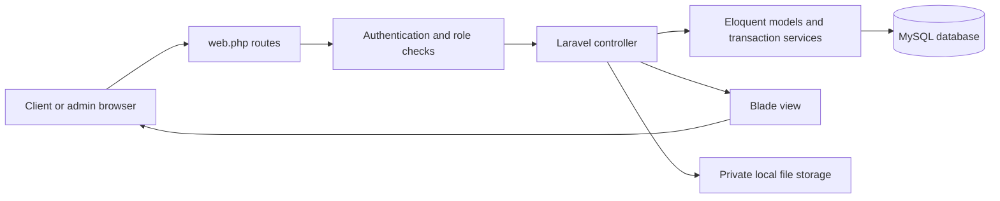
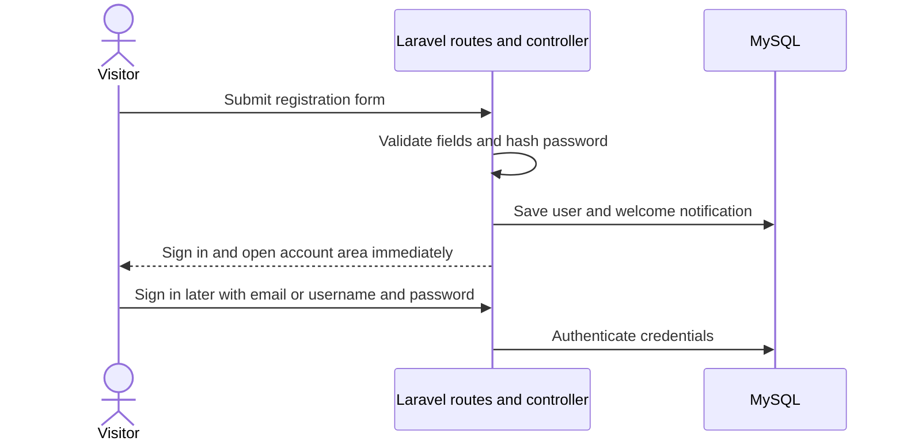
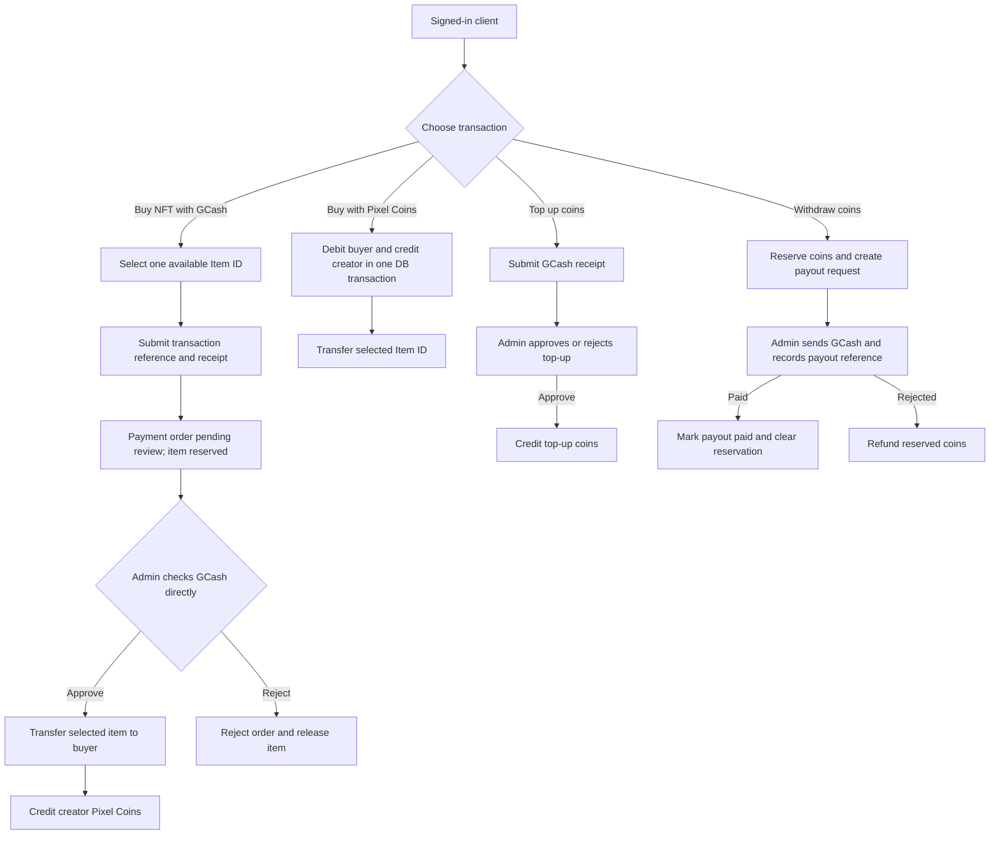
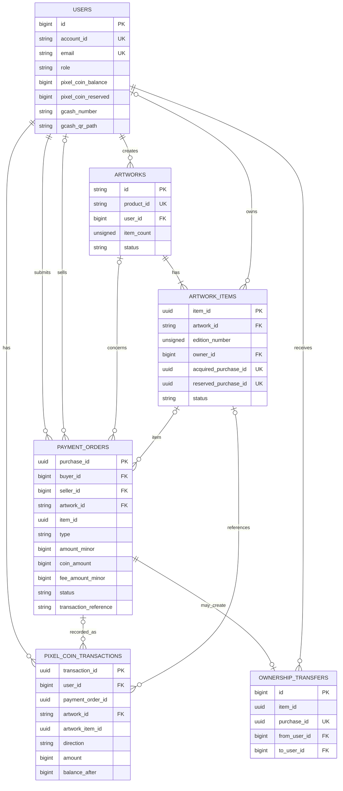

# Pixmoree Project Diagrams

These diagrams describe the current Laravel MVC application and manual payment workflow. The database schema is defined by the Laravel migrations in database/migrations.

## 1. MVC request and data flow

## 2. Account registration and sign-in

## 3. Client and admin transaction flow

## 4. Relational database diagram (ERD)

Edition item IDs are unique. A pending GCash order reserves its selected item, and approval transfers that item in a database transaction. Coin balances and ledger amounts are stored in hundredths of a Pixel Coin.

Payment-order and ledger Item ID fields are application-validated UUID references; the current schema does not define foreign-key constraints for those item references. User, artwork, and purchase relationships marked FK are enforced by database constraints.
