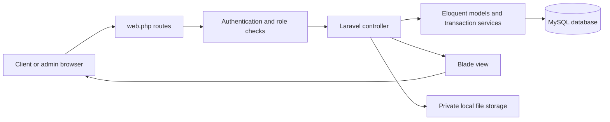
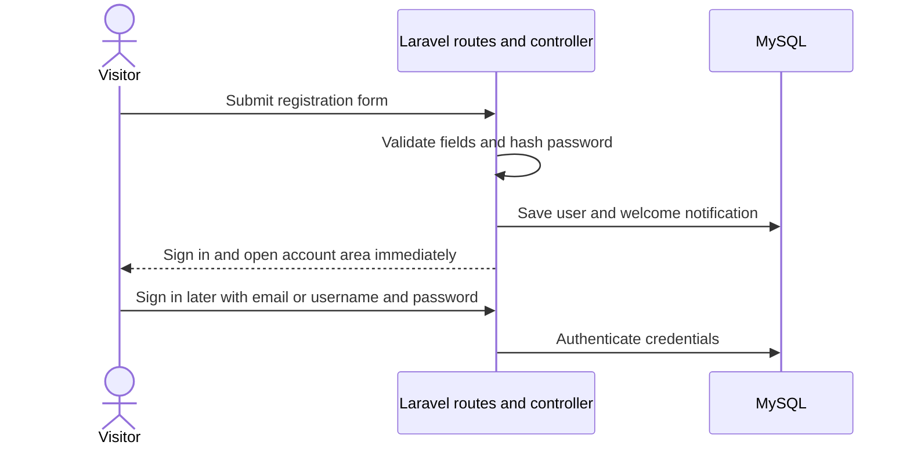
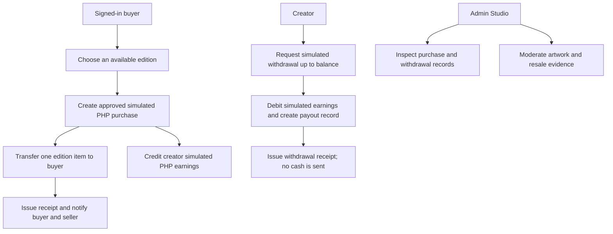
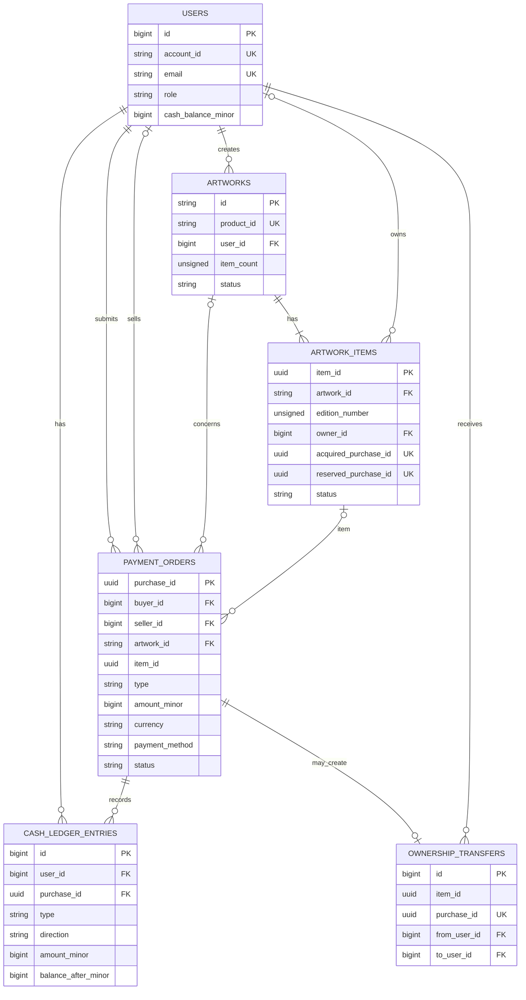

# Pixmoree Project Diagrams

These diagrams describe the current Laravel MVC application and its simulation-only purchase and withdrawal workflow. Laravel migrations define the current schema.

## 1. MVC request and data flow

## 2. Account registration and sign-in

## 3. Simulated transaction flow

## 4. Relational database diagram (ERD)

Edition item IDs are unique. Each simulated purchase transfers its selected item and records the purchase atomically. Cash balances and ledger amounts are stored as integer centavos and represent in-app demo values only. A purchase has one ledger entry for the creator; a simulated withdrawal has one debit entry for the creator. Historical migrations contain the removed Pixel Coin schema, and the cleanup migration drops its table and balance fields.

Payment-order and ownership-transfer item ID fields are application-validated UUID references; the current schema does not define foreign-key constraints for those item references. User, artwork, purchase, and cash-ledger relationships marked FK are enforced by database constraints.
